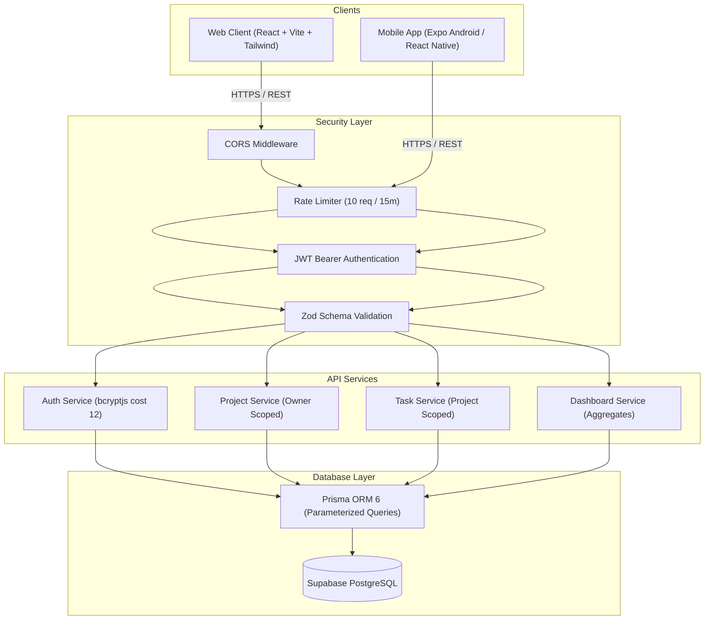
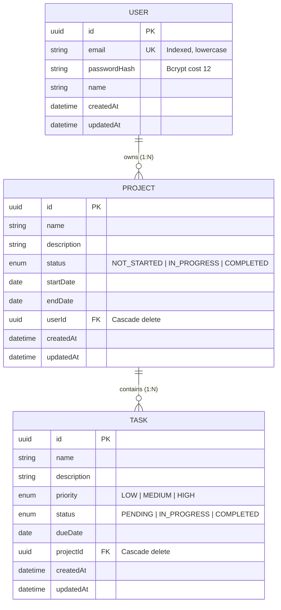

# Project Management System (Web + Mobile)

A unified, multi-platform Project Management System built with a shared Node.js/Express REST backend, Supabase PostgreSQL, a React/Vite responsive web app, and a React Native/Expo Android mobile app.

---

## 1. System Overview & Architecture

Both Web and Mobile clients talk to the **exact same backend and database** with zero duplicated APIs. A user registered on either platform can log in on the other, view the same projects and tasks, and changes synchronize across platforms upon refresh.



---

## 2. Features Mapped to Specification

### 🔐 1. Authentication
- **User Registration & Login**: Full Name, Email, Password.
- **Security**: Case-insensitive unique emails, bcrypt hashing with cost 12, passwords never stored or returned.
- **Persistence**: Token stored in `localStorage` on Web and **Android Keystore** via `expo-secure-store` on Mobile.
- **Single Account**: Identical database; registration on one works immediately on the other.

### 📁 2. Project Management
- **Operations**: Create, View, Edit, and Delete projects.
- **Fields**: Project Name, Description, Status (`Not Started`, `In Progress`, `Completed`), Start Date, End Date, Created Date.
- **Strict Isolation**: Users can only see and modify their own projects. Accessing unowned IDs returns HTTP `404 Not Found`.

### 📝 3. Task Management
- **Operations**: Create, View, Edit, Delete, and inline "Mark Completed" toggle.
- **Fields**: Task Name, Description, Priority (`Low`, `Medium`, `High`), Status (`Pending`, `In Progress`, `Completed`), Due Date, Created Date.
- **Normalized Ownership**: Ownership flows `Task → Project → User` without redundant foreign keys.

### 📊 4. Dashboard
- **5 Core Metrics**:
  1. Total Projects
  2. Total Tasks
  3. Completed Tasks
  4. Pending Tasks
  5. Projects In Progress
- Plus in-progress tasks count and percentage progress breakdown.

### 🔍 5. Search and Filtering
- Search projects by name (case-insensitive substring match).
- Search tasks by name and description.
- Filter projects by status (`Not Started`, `In Progress`, `Completed`).
- Filter tasks by status (`Pending`, `In Progress`, `Completed`).
- Filter tasks by priority (`Low`, `Medium`, `High`).

### 📱 6. Mobile App (Expo / Android)
- **Pull-to-Refresh**: Seamless sync on all lists and dashboard.
- **Secure Token Storage**: Hardware-backed Android Keystore via `expo-secure-store`.
- **Expired Token Handling**: 401 interceptor deletes token and navigates to login with `"Your session has expired. Please log in again."` notice.
- **No Network Handling**: Listens to NetInfo and displays a top alert banner (`"No internet connection. Please check your network."`) without crashing or blanking.

---

## 3. Database Schema (ER Diagram)



Detailed schema documentation is located in [`docs/DATABASE_SCHEMA.md`](./docs/DATABASE_SCHEMA.md).

---

## 4. Tech Stack

| Component | Technology | Rationale |
| :--- | :--- | :--- |
| **Backend** | Node.js + Express + TypeScript | Fast, typed, lightweight REST API architecture |
| **ORM** | Prisma 6 (`@prisma/client@6`) | Parameterized queries, migration safety, type-safe models |
| **Database** | Supabase PostgreSQL | Managed relational cloud PostgreSQL |
| **Validation**| Zod | Shared runtime schema validation on body, query, and params |
| **Security** | Helmet, CORS, Express-Rate-Limit, bcryptjs (12) | Defense-in-depth security best practices |
| **Web** | React 18 + Vite + Tailwind CSS + Lucide | Fast HMR, responsive styling, modern UI components |
| **Mobile** | React Native + Expo (SDK 52) + Expo Router | Cross-platform native mobile app with file routing |
| **Mobile Security** | `expo-secure-store` | Hardware-backed Android Keystore token encryption |
| **Testing** | Vitest + Supertest | Unit & integration security tests |

---

## 5. Repository Structure

```
ISMOProjectManagement/
├── shared/                  # Source of truth for Zod schemas & DTO types
│   ├── schemas/             # auth.ts, project.ts, task.ts
│   ├── types.ts             # Enums and TypeScript interfaces
│   └── sync.mjs             # Copies shared contracts into backend, web, mobile
├── backend/                 # Express REST API
│   ├── prisma/              # schema.prisma, seed.ts
│   ├── src/                 # routes, controllers, services, middleware
│   ├── tests/               # Vitest + Supertest integration tests
│   └── Dockerfile
├── web/                     # React Vite Single Page Application
│   ├── src/                 # pages, components, context, api
│   ├── nginx.conf
│   └── Dockerfile
├── mobile/                  # React Native Expo application
│   ├── app/                 # Expo Router file-based screens
│   ├── src/                 # storage, context, api, components
│   └── eas.json             # EAS build config for Android APK
├── docs/                    # Full documentation catalog
│   ├── API.md               # Complete REST API reference
│   ├── DATABASE_SCHEMA.md   # Schema & ER diagram details
│   ├── DEPLOYMENT_GUIDE.md  # Render, Vercel, Supabase, EAS guides
│   └── VIDEO_DEMO_SCRIPT.md # 5-minute video recording checklist
├── docker-compose.yml       # One-command full-stack container launch
└── README.md
```

---

## 6. Environment Variables

### Backend (`backend/.env`)
| Variable | Description | Example |
| :--- | :--- | :--- |
| `DATABASE_URL` | Supabase Transaction Pooler (Port 6543) | `postgresql://...:6543/postgres?pgbouncer=true&connection_limit=1` |
| `DIRECT_URL` | Supabase Session Pooler or Direct (Port 5432) | `postgresql://...:5432/postgres` |
| `JWT_SECRET` | Secret key for HS256 tokens ($\ge 32$ chars) | `your-secure-random-jwt-secret-string-at-least-32-chars` |
| `JWT_EXPIRES_IN` | Token validity duration | `7d` |
| `NODE_ENV` | Environment mode | `development` / `production` |
| `PORT` | API server listening port | `5000` |
| `CORS_ORIGINS` | Allowed frontend domains | `http://localhost:5173,http://localhost:3000` |

### Web (`web/.env`)
| Variable | Description | Example |
| :--- | :--- | :--- |
| `VITE_API_URL` | Base URL of the backend API | `http://localhost:5000` |

### Mobile (`mobile/.env`)
| Variable | Description | Example |
| :--- | :--- | :--- |
| `EXPO_PUBLIC_API_URL` | Backend API URL for mobile | `http://192.168.1.10:5000` (LAN) or Render URL |

---

## 7. Getting Started Locally

### Prerequisites
- Node.js 20+ installed
- Git installed
- Supabase account (or local Docker PostgreSQL)

### 1. Database Setup (Supabase)
1. Create a free project on [supabase.com](https://supabase.com).
2. Copy the two connection strings from **Project Settings $\rightarrow$ Database**:
   - Connection Pooling (Port 6543) $\rightarrow$ `DATABASE_URL`
   - Direct/Session Pooler (Port 5432) $\rightarrow$ `DIRECT_URL`
3. Create `backend/.env` (copy from `backend/.env.example`) and paste your URLs.
4. Run migrations and seed data:
   ```bash
   cd backend
   npm run db:push
   npm run db:seed
   ```
   > **Demo Credentials**: Email: `demo@example.com` | Password: `Password123!`

### 2. Start the Backend API
```bash
cd backend
npm run dev
# Server starts at http://localhost:5000
# Health check: http://localhost:5000/health
```

### 3. Start the Web Frontend
```bash
cd web
npm run dev
# Web app runs at http://localhost:5173
```

### 4. Start the Mobile App (Expo Go)
```bash
cd mobile
npm run start
```
- Open the **Expo Go app** on your Android device.
- Scan the QR code displayed in your terminal.
- Ensure your phone is connected to the same Wi-Fi network as your computer, and set `EXPO_PUBLIC_API_URL=http://<YOUR_COMPUTER_IP>:5000`.

---

## 8. Docker Support (One-Command Run)

To run the entire system (PostgreSQL 16, Express Backend, and React Web) without installing local dependencies:

```bash
docker compose up --build
```
- Web Application: `http://localhost:3000`
- Backend API: `http://localhost:5000`
- PostgreSQL: `localhost:5433`

---

## 9. Automated Testing

Run the full backend integration and security test suite:

```bash
cd backend
npm test
```

### Test Coverage Highlights:
- User registration, duplicate email handling (409), password strength enforcement.
- Login validation, invalid credentials error normalization.
- JWT verification, token expiration, and unauthenticated route rejection.
- Strict data isolation: verifies User B cannot view, modify, or delete User A's projects or tasks.
- Cascade deletion: verifies deleting a project safely removes nested tasks.
- Aggregated dashboard computation accuracy.

---

## 10. Production Deployment

- **Database**: Supabase PostgreSQL.
- **Backend API**: Render Web Service (Root directory: `backend`).
- **Web App**: Vercel SPA (Root directory: `web`).
- **Mobile Standalone APK**: EAS Build:
  ```bash
  cd mobile
  eas build -p android --profile preview
  ```

Complete instructions are provided in [`docs/DEPLOYMENT_GUIDE.md`](./docs/DEPLOYMENT_GUIDE.md).

---

## 11. Security Architecture Summary

1. **Password Hashing**: `bcryptjs` with salt cost 12. Password hashes are never logged, echoed, or included in JSON responses.
2. **JWT Authentication**: HS256 algorithm with 7-day expiration. All protected routes require `Authorization: Bearer <token>`.
3. **Data Isolation**: Every database query explicitly scopes `userId: req.user.userId`. Attempting to access another user's resources yields HTTP 404.
4. **Input Validation**: Centralized Zod schemas validate request bodies, URL params, and query strings. Rejects unknown properties via `.strict()`.
5. **Rate Limiting**: `express-rate-limit` protects authentication endpoints (10 attempts per 15 minutes per IP) to mitigate brute-force attacks.
6. **SQL Injection Prevention**: Built entirely with Prisma ORM parameterized queries; no raw unsanitized SQL.
7. **Secure Mobile Storage**: Hardware-backed Android Keystore via `expo-secure-store`.
8. **Network & Error Resilience**: Friendly error banners on connection drops; graceful session expiry redirects.

---

## 12. Bonus Features Implemented

- ✅ **Shared Types & Validation**: Centralized in `shared/` and synced via `sync.mjs`.
- ✅ **Docker Support**: Full `docker-compose.yml` with multi-stage Dockerfiles.
- ✅ **Integration Test Suite**: Vitest + Supertest covering the complete security test matrix.
- ✅ **Pagination & Sorting**: Built into project and task endpoints.
- ✅ **Database Seeder**: Realistic demo data with multi-status projects and tasks.
- ✅ **Stand-Alone Android APK Pipeline**: EAS Build configuration.
