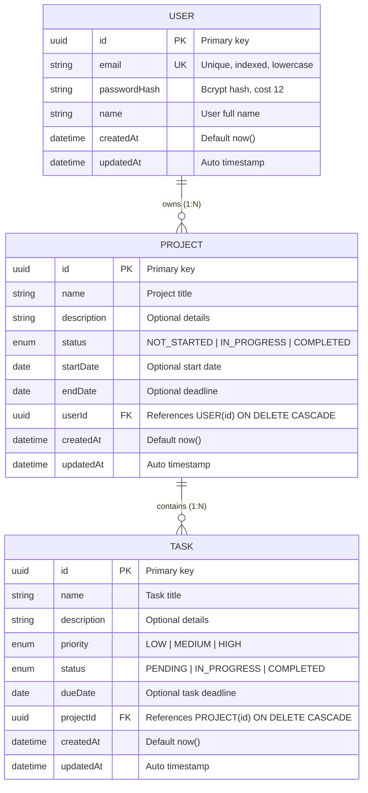

# Database Schema & Entity-Relationship (ER) Documentation

This document describes the relational database design powering the Project Management System.

---

## 1. Entity-Relationship (ER) Diagram

---

## 2. Table Specifications

### 2.1 `users` Table
| Column | Type | Constraints | Description |
| :--- | :--- | :--- | :--- |
| `id` | `UUID` | `PRIMARY KEY`, Default: `uuid()` | Unique user identifier |
| `email` | `VARCHAR(255)` | `UNIQUE`, `NOT NULL`, `INDEX` | Stored in trimmed lowercase |
| `password_hash`| `VARCHAR(100)` | `NOT NULL` | Bcrypt hash with salt rounds = 12 |
| `name` | `VARCHAR(100)` | `NOT NULL` | User full name |
| `created_at` | `TIMESTAMP` | `NOT NULL`, Default: `now()` | Registration timestamp |
| `updated_at` | `TIMESTAMP` | `NOT NULL` | Auto updated timestamp |

### 2.2 `projects` Table
| Column | Type | Constraints | Description |
| :--- | :--- | :--- | :--- |
| `id` | `UUID` | `PRIMARY KEY`, Default: `uuid()` | Unique project identifier |
| `name` | `VARCHAR(200)` | `NOT NULL` | Project name |
| `description` | `TEXT` | `NULLABLE` | Detailed description |
| `status` | `ENUM` | Default: `NOT_STARTED` | `NOT_STARTED`, `IN_PROGRESS`, `COMPLETED` |
| `start_date` | `DATE` | `NULLABLE` | Scheduled start date |
| `end_date` | `DATE` | `NULLABLE` | Scheduled end date |
| `user_id` | `UUID` | `FOREIGN KEY` $\rightarrow$ `users(id)`, `ON DELETE CASCADE` | Project owner |
| `created_at` | `TIMESTAMP` | `NOT NULL`, Default: `now()` | Creation timestamp |
| `updated_at` | `TIMESTAMP` | `NOT NULL` | Auto updated timestamp |

**Indexes**:
- `@@index([userId])`: Fast filtering of user projects.
- `@@index([userId, status])`: Compound index for status-filtered queries and dashboard stats.

### 2.3 `tasks` Table
| Column | Type | Constraints | Description |
| :--- | :--- | :--- | :--- |
| `id` | `UUID` | `PRIMARY KEY`, Default: `uuid()` | Unique task identifier |
| `name` | `VARCHAR(200)` | `NOT NULL` | Task title |
| `description` | `TEXT` | `NULLABLE` | Task details |
| `priority` | `ENUM` | Default: `MEDIUM` | `LOW`, `MEDIUM`, `HIGH` |
| `status` | `ENUM` | Default: `PENDING` | `PENDING`, `IN_PROGRESS`, `COMPLETED` |
| `due_date` | `DATE` | `NULLABLE` | Deadline |
| `project_id` | `UUID` | `FOREIGN KEY` $\rightarrow$ `projects(id)`, `ON DELETE CASCADE` | Associated project |
| `created_at` | `TIMESTAMP` | `NOT NULL`, Default: `now()` | Creation timestamp |
| `updated_at` | `TIMESTAMP` | `NOT NULL` | Auto updated timestamp |

**Indexes**:
- `@@index([projectId])`: Fast retrieval of project tasks.
- `@@index([projectId, status])`: Fast filtering by task completion.
- `@@index([projectId, priority])`: Fast filtering by task priority.

---

## 3. Database Normalization Justification

### Why `Task` has NO `userId` column
In normalized 3NF database design:
1. Every task strictly belongs to exactly one `Project`.
2. Every project strictly belongs to exactly one `User`.
3. If `Task` had a redundant `userId` column, an update could create an anomaly where `task.userId !== project.userId` (e.g. User A owns the project, but User B is stored on the task).
4. By enforcing `Task → Project → User` in both the schema and the service query layer (`where: { project: { userId } }`), data consistency is mathematically guaranteed.
